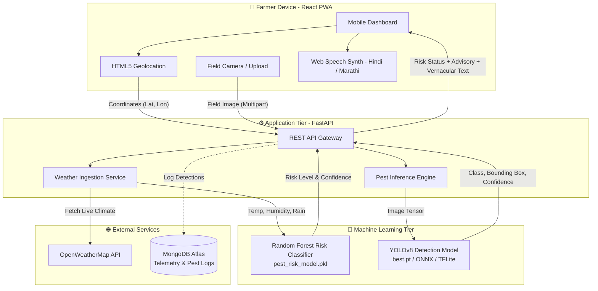

# 🌾 CropGuard Intelligence 🛡️
### *AI-Powered Smart Pest Outbreak Forecasting & Visual Diagnosis for Indian Agriculture*

[](https://opensource.org/licenses/MIT)
[](https://www.python.org/)
[](https://fastapi.tiangolo.com/)
[](https://react.dev/)
[](https://ultralytics.com)
[](https://scikit-learn.org/)
[]()

---

## 📌 Overview

**CropGuard Intelligence** (formerly *Agrisentry AI*) is an end-to-end intelligent agricultural decision-support system tailored for Indian farmers. Agricultural productivity across India suffers catastrophic losses annually—up to **30-35% of total yield**—due to delayed pest detection, misdiagnosis, and unscientific pesticide spraying.

CropGuard tackles this crisis at its root by combining **predictive weather-driven epidemiology** with **edge-friendly visual deep learning** and **voice-first vernacular accessibility**:

1. **Predictive Risk Modeling:** Predicts imminent pest outbreaks before they manifest by analyzing real-time micro-climatic patterns (temperature, relative humidity, precipitation, seasonal trends).
2. **Instant Visual Pest Classification:** Identifies crop pests from smartphone photos using computer vision models trained on agricultural pest benchmarks.
3. **Vernacular Voice Guidance:** Delivers actionable organic and chemical remediation instructions via synthetic speech in regional languages (**हिन्दी - Hindi** and **मराठी - Marathi**).
4. **Offline-Ready Progressive Web App (PWA):** Designed for low-bandwidth rural connectivity environments with geolocation auto-sync.

---

## 🚀 Key Features

| Feature | Description | Target Benefit |
|---|---|---|
| 🌦️ **Micro-Climate Risk Forecasting** | Random Forest ML classifier analyzing weather parameters from OpenWeatherMap to compute pest outbreak risk levels (`Low`, `Medium`, `High`). | Enables preventive early intervention before pest populations surge. |
| 🔍 **Visual Pest Diagnosis** | YOLOv8 object detection trained to identify major agricultural pests (Bollworm, Aphid, Brown Plant Hopper, Locust, Whitefly, Mite). | Eliminates incorrect diagnosis and inappropriate pesticide selection. |
| 🗣️ **Multilingual Voice Advisory** | Web Speech API delivering bilingual audio advisories (Hindi and Marathi) with dosage, safety intervals, and organic treatments (e.g. Neem oil). | Bridges literacy barriers for marginal and smallholder farmers. |
| 📍 **GPS-Enabled Hyperlocal Insights** | Browser-based HTML5 Geolocation automatically pulls ambient field weather coordinates. | Zero manual configuration required by the farmer. |
| 🧪 **IPM Advisory & Dosage Engine** | Provides Integrated Pest Management (IPM) protocols balancing bio-pesticides with targeted chemical controls. | Prevents soil degradation, pesticide resistance, and toxic runoff. |
| 📱 **Lightweight Mobile PWA** | Mobile-responsive UI built with React.js and Service Workers for field resilience. | Fast loading on low-cost Android smartphones and 3G/4G networks. |

---

## 🏗️ System Architecture



---

## 🔬 Machine Learning Pipeline

### 1. Pest Outbreak Risk Model (`RandomForestClassifier`)
- **Input Variables:**
  - Ambient Temperature (°C)
  - Relative Humidity (%)
  - Rainfall / Precipitation (mm)
  - Cropping Month (Phenological seasonality)
- **Target Classification:**
  - `0 - Low Risk`: Unfavorable conditions for pest propagation.
  - `1 - Medium Risk`: Moderate humidity and temperature; threshold monitoring advised.
  - `2 - High Risk`: Critical breeding window (e.g. 28°C–38°C with >75% humidity); immediate preventive biological or cultural control recommended.
- **Serialization:** Trained and exported via `joblib` into `pest_risk_model.pkl`.

### 2. Pest Object Detection & Recognition (`YOLOv8`)
- **Dataset Configuration:** Configured in `dataset/data.yaml` across major Indian cropping pests:
  - `0`: Locust (*Schistocerca gregaria*)
  - `1`: Aphid (*Aphidoidea*)
  - `2`: Bollworm (*Helicoverpa armigera*)
  - `3`: Brown Plant Hopper (*Nilaparvata lugens*)
  - `4`: Whitefly (*Bemisia tabaci*)
  - `5`: Spider Mite (*Tetranychidae*)
- **Training Dataset Benchmark:** Derived from the **IP102** benchmark (Large-Scale Benchmark Dataset for Insect Pest Recognition).
- **Edge Deployment Target:** Exportable to ONNX and TFLite for zero-latency on-device smartphone inference.

---

## 📂 Repository Structure

```
cropguard-intelligence/
├── backend/
│   ├── main.py                     # FastAPI backend application & API routes
│   └── requirements.txt            # Python dependencies (FastAPI, uvicorn, scikit-learn, etc.)
├── dataset/
│   ├── data.yaml                   # YOLO dataset configuration & class labels
│   ├── train/
│   │   ├── images/                 # Training images
│   │   └── labels/                 # YOLO format ground truth labels
│   └── val/
│       ├── images/                 # Validation images
│       └── labels/                 # Validation labels
├── deployment/
│   └── README.md                   # Cloud & edge deployment guide (Render, AWS, Vercel)
├── frontend/
│   ├── public/                     # PWA assets, manifest.json, index.html
│   ├── src/
│   │   ├── App.js                  # Main React application & speech logic
│   │   ├── App.css                 # Application styling
│   │   ├── index.js                # React entrypoint
│   │   └── service-worker.js       # Offline caching service worker
│   └── package.json                # Frontend dependencies
├── models/
│   ├── ai_engine.py                # Model training, synthetic data generator, & evaluation
│   └── best.pt                     # Exported YOLO model weights
├── test_images/
│   ├── aphid.png                   # Test sample for Aphid detection
│   ├── bollworm.png                # Test sample for Bollworm detection
│   └── locust.png                  # Test sample for Locust detection
├── pest_risk_model.pkl             # Serialized Scikit-Learn Random Forest model
├── .gitignore                      # Git ignore patterns
└── README.md                       # Comprehensive project documentation
```

---

## 🛠️ Installation & Setup

### Prerequisites
- Python 3.9+ and `pip`
- Node.js 18+ and `npm`
- Git

### 1. Clone the Repository
```bash
git clone https://github.com/ASHUTOSHNIMBALKAR/cropguard-intelligence.git
cd cropguard-intelligence
```

### 2. Backend Setup
```bash
# Navigate to backend
cd backend

# Create and activate virtual environment
python -m venv venv
# On Windows:
venv\Scripts\activate
# On Linux/macOS:
source venv/bin/activate

# Install dependencies
pip install -r requirements.txt

# (Optional) Export your OpenWeatherMap API key
export OPENWEATHER_API_KEY="your_api_key_here"  # On Windows: set OPENWEATHER_API_KEY="your_api_key_here"

# Run the FastAPI server
uvicorn main:app --host 0.0.0.0 --port 8000 --reload
```
API Documentation will be live at: `http://localhost:8000/docs`

### 3. Frontend Setup
```bash
# Open a new terminal and navigate to frontend
cd frontend

# Install dependencies
npm install

# Start development server
npm start
```
The application will open in your browser at `http://localhost:3000`.

---

## 📡 API Reference

### 1. Predict Pest Outbreak Risk
- **Endpoint:** `POST /predict-risk`
- **Request Body:**
  ```json
  {
    "lat": 18.5204,
    "lon": 73.8567
  }
  ```
- **Response:**
  ```json
  {
    "risk": "High",
    "accuracy": "94.2%",
    "temp": 31.4,
    "humidity": 82,
    "location": "Pune",
    "message": "Risk is High (Model Confidence: 94.2%). Take appropriate measures."
  }
  ```

### 2. Identify Pest from Field Image
- **Endpoint:** `POST /predict-insect`
- **Payload:** `multipart/form-data` with `file: <image>`
- **Response:**
  ```json
  {
    "insect_name": "Brown Plant Hopper",
    "category": "HARMFUL",
    "scientific_name": "Nilaparvata lugens",
    "confidence": 0.92,
    "recommendation": "Use Azadirachtin (Neem Oil) or Pymetrozine 50% WG.",
    "voice_text_hi": "यह एक भूरा पौधा फुदका है। यह फसल के लिए हानिकारक है। नीम के तेल का प्रयोग करें।",
    "voice_text_mr": "हा एक तपकिरी तुडतुडा आहे. तो पिकासाठी हानिकारक आहे. निंबोळी अर्काचा वापर करा."
  }
  ```

---

## 🗺️ Roadmap

- [x] Initial Scikit-Learn risk classification pipeline
- [x] Weather API integration with OpenWeatherMap
- [x] Mobile-responsive React PWA interface
- [x] Multilingual voice synthesis (Hindi & Marathi)
- [x] YOLOv8 dataset format & benchmark pipeline
- [ ] On-device TFLite model integration for 100% offline inference
- [ ] Satellite imagery integration (Sentinel-2 NDVI for vegetation stress analysis)
- [ ] Community pest outbreak crowdsourcing map across talukas / districts
- [ ] Integration with WhatsApp Farmer Advisory Bot

---

## 👨‍💻 Author

**Ashutosh Nimbalkar**  
- GitHub: [@ASHUTOSHNIMBALKAR](https://github.com/ASHUTOSHNIMBALKAR)
- Email: [ashunimbalkar05@gmail.com](mailto:ashunimbalkar05@gmail.com)

---

## 📄 License

This project is licensed under the [MIT License](LICENSE).

